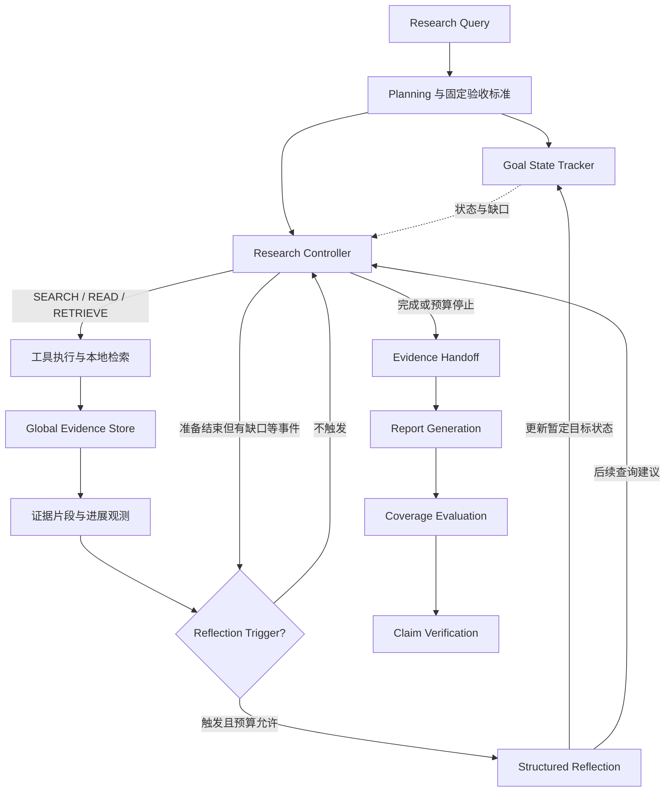

# Adaptive Deep Research Agent

**Budget-Aware Deep Research Agent with Goal Tracking and Event-Triggered Reflection**

一个研究有限工具调用与模型预算下，信息检索质量和成本如何权衡的研究 Agent。基于 LangGraph 构建动态研究循环，通过目标状态跟踪、事件触发反思和可追溯证据核验，生成带引用的报告并记录完整行动轨迹。

核心问题是：**什么时候应该继续搜索、重新检索已有证据、反思研究方向，或结束研究？**

- **Goal-Aware Planning**：将问题组织为固定验收目标，另外维护目标状态、信息缺口和证据引用。
- **Event-Triggered Reflection**：在停滞、目标缺口或疑似冲突等事件出现时尝试反思，受次数和预算限制。
- **Adaptive Research Policy**：由模型选择 SEARCH、READ、RETRIEVE、FINISH，程序执行预算与来源范围约束。
- **Evidence-Grounded Evaluation**：共享原文、BM25 选段、带引用生成，以及写作后的覆盖评估和声明核验。
- **Reproducible Evaluation**：支持关闭反思、事件反思、每步反思和上下文对照，保存配置、轨迹、失败及成本。

**Tech Stack:** Python · LangGraph · Pydantic · BM25 · DeepSeek API · Tavily

> **Research Status:** 核心研究和评测链路已实现；当前只有探索性单任务结果，尚未证明 Event Reflection 的质量或成本收益。当前架构为 `global_research_v2`。

[架构](#architecture) · [核心算法](#algorithms) · [实验结果](#results) · [快速开始](#quick-start) · [评测](#evaluation) · [实现详解](docs/implementation.md) · [后续优化](#roadmap)

<a id="architecture"></a>

## Architecture — 研究反馈循环



这是**概念反馈图**，不是源码逐边对应图。目标状态由反思更新，最终报告评分不反馈给研究调度。实际节点路由、预算停止与版本字段见 [架构设计](docs/architecture.md)。

| 模块 | 主要职责 | 代码与细节 |
| --- | --- | --- |
| [研究简报](docs/implementation.md#module-brief) | 定义问题范围和固定验收项 | `planning.py`、`policy.py` |
| [目标与反思](docs/implementation.md#module-reflection) | 维护目标状态、决定是否反思 | `research_control.py`、`graph.py` |
| [研究控制器](docs/implementation.md#module-controller) | 选择动作并执行硬预算 | `graph.py`、`research_models.py` |
| [共享证据库](docs/implementation.md#module-evidence) | 原文共享、URL 去重、出处记录 | `evidence_store.py` |
| [搜索与抓取](docs/implementation.md#module-tools) | 获取正文并检查来源范围 | `tools.py`、`domains.py` |
| [本地检索](docs/implementation.md#module-retrieval) | BM25 排序与片段分配 | `evidence_store.py` |
| [证据交接与写作](docs/implementation.md#module-writing) | 汇合历史片段并生成报告 | `graph.py`、`policy.py` |
| [最终评估](docs/implementation.md#module-evaluation) | 按验收项评分，可独立重评 | `coverage.py`、`report_evaluation.py` |
| [声明核验](docs/implementation.md#module-verification) | 检查实际引用是否支持声明 | `verification.py` |

模块是职责划分，不是九个独立文件夹或九个 Agent。目录树、函数分工和状态交接表见 [Implementation Details](docs/implementation.md)。

<a id="algorithms"></a>

## Key Algorithms — 核心机制

### Event-Triggered Reflection

反思会增加模型调用，是否值得执行取决于当前研究状态。本项目将触发规则与反思模型分开，比较以下事件触发方式与关闭反思、每步反思的行为差异。

| 触发事件 | 目的 | 当前约束 |
| --- | --- | --- |
| 连续两步没有新增证据 | 识别检索停滞、调整方向 | 停滞触发至少间隔两步 |
| 步骤预算过半且仍有目标缺口 | 检查剩余研究重点 | 半程事件每次运行最多触发一次 |
| 准备结束但仍有目标缺口 | 检查是否需要继续研究 | 同一步不重复触发 |
| 研究者报告疑似冲突 | 请求进一步检查 | 冲突标记是模型报告，并非独立事实检测 |

反思默认最多尝试三次，失败也计数，并需为下一次决策和写作留出模型额度。compact 输入保留目标、缺口、最近三步和有限原文；full 用于上下文对照。

**设计取舍：** “新增证据”依据来源变化和原文区间增量，不等于语义信息增益。反思可能增加检索而不提高答案质量，因此同时观察覆盖、声明支持、Token 和预算耗尽情况，不能只统计反思成功率。

### Goal-Aware Planning & Tracking

简报固定问题范围与验收标准，初始查询是建议，不是执行队列。研究控制器根据工具观测生成新查询，选择搜索、抓取、本地检索或停止。

| 目标状态 | 含义 |
| --- | --- |
| `unexplored` | 尚未形成有效判断 |
| `partial` | 有证据，但未支持全部要求 |
| `supported` | 模型判断目标已获支持，且没有未解决事实 |
| `conflicted` | 模型报告不兼容证据，须附至少两条不同引文 |

这些是**暂定研究状态**，不是最终报告评分。原验收描述不被反思改写，但模型生成的缺口仍可能扩张要求，属于待校准问题。

### Evidence-Grounded Generation & Verification

搜索正文进入共享原文库，BM25 从全部已读取来源选取片段。写作交接合并主题查询、行动查询和历史片段，保留 URL、正文哈希与字符偏移。

报告完成后分别检查：

- **Coverage Evaluation**：报告是否回答固定验收项，并有原文支持。
- **Claim Verification**：每条声明实际引用的来源是否支持它，输出 supported / contradicted / insufficient。

位置校验证明引文存在，模型判断语义支持；两者不能等同于人工事实认证。评分失败保留未完成，已完成低分不会为了提高分数而重试。具体规则见 [最终评估](docs/semantic-coverage.md)。

<a id="results"></a>

## Experiments & Results — 探索性结果

**任务：** 根据官方文档说明 LangGraph Python 的状态管理与条件路由机制。使用固定简报、DeepSeek Chat、相同来源范围及预算：8 次外部请求、12 步研究行动、32 次模型调用。每组仅运行一次，模型版本以当时供应商别名为准。

| 指标 | Baseline（关闭反思） | Event（事件反思） |
| --- | ---: | ---: |
| Research Steps | 6 | 12 |
| External Requests | 3 | 3 |
| Read Sources | 11 | 10 |
| Reflection Calls / Failures | 0 / 0 | 1 / 0 |
| Model Calls | 21 | 31 |
| Total Tokens | 83,875 | 163,493 |
| Latency | 71.9 s | 117.6 s |
| Semantic Coverage | 50.0% | 50.0% |
| Supported Claim Rate | 81.8%（9/11） | 93.3%（14/15） |
| Evaluation / Claim Check | completed / completed | completed / completed |
| Stop Reason | researcher_complete | step_budget |

来源是用户提供的 2026-10-21 云端运行，代码提交 `8a21af2`。运行 ID、模型配置、精确指标与评分版本见 [结果元数据](docs/results-20261021.json)；该文件是摘录，不含完整原文和运行轨迹，不应视为完整可离线重放的数据集。

**能够观察到：** Event 在本次运行中 Token 增加约 94.9%、耗时增加约 63.5%，覆盖率相同。两组评估均第一次成功，未实际触发失败重试。

**不能据此得出：** Event 整体质量更高。两组声明数和内容不同；样本只有一次；已发现评估重新检索可能遗漏写作证据，影响低分解释。实现完成与算法有效是不同结论。

早期批次的 Baseline 评分未完成，其空值不能当作零分，也不能与本表合并。历史记录、最新轨迹案例和评分偏差说明见 [实验记录](docs/results.md)。

<a id="quick-start"></a>

## Quick Start — 最短运行路径

需要 **Python 3.11+、uv、模型 API Key 和 Tavily Key**，无需本地 GPU/NPU。以下命令在仓库根目录执行。

**安装依赖：**

```sh
uv sync --locked --extra dev --extra live
cp .env.example .env
chmod 600 .env
```

编辑 `.env`，至少填写：

```dotenv
ADRA_MODEL=deepseek:deepseek-chat
DEEPSEEK_API_KEY=你的密钥
TAVILY_API_KEY=你的密钥
```

程序不自动加载 `.env`。在当前 shell 加载自己创建且可信的文件：

```sh
set -a
source .env
set +a
```

**真实运行，会调用模型和搜索 API：**

```sh
UV_HTTP_TIMEOUT=300 uv run --locked --extra live adra \
  '根据官方文档，说明 LangGraph 的状态管理与条件路由机制' \
  --plan data/live-eval/langgraph-state-routing.json \
  --allowed-domain docs.langchain.com \
  --allowed-domain reference.langchain.com \
  --max-tools 8 --max-steps 12 --max-model-calls 32
```

不传 `--plan` 时自动生成研究简报。报告保存在 `outputs/<run-id>/report.md`；完整配置、阶段模型选择、CLI 参数和错误口径见 [使用指南](docs/usage.md)。

**本地回归测试，不调用付费 API：**

```sh
uv run --locked --extra dev --extra live pytest -q
```

<a id="evaluation"></a>

## Evaluation — 复现实验与评估口径

固定计划、模型配置、来源范围和预算，分别比较：

| 批次组别 | 反思模式 | 用途 |
| --- | --- | --- |
| `baseline` | off | 当前相同研究链路关闭反思，不是旧架构 |
| `event` | event + compact | 事件触发与压缩输入 |
| `always` | always + compact | 每步触发，仍受最多三次和预算限制 |
| `event-full` | event + full | 与 event 对比反思输入长度 |

**批次预览，不调用 API：**

```sh
uv run --locked --extra live python -m adra.live_evaluation \
  --cases langgraph-state-routing python-asyncio pydantic-validation \
  --variants baseline event always --repeat 3 \
  --max-tools 8 --max-steps 12 --max-model-calls 48
```

**只有追加 `--execute` 才执行上述 27 次真实研究，并产生 API 消耗。** 这里的 48 次模型调用上限是下一批配置，与 Results 中的 32 不同，不应把新旧批次混为同一实验。建议先修复评估证据一致性，再执行大批次。

指标需同时查看：覆盖率衡量满足验收项的比例，声明支持率衡量模型对实际引用的判断，引用 ID 有效率只检查 ID 存在。任一评估未完成应单独报告，null 不补零；Token 分阶段统计，不能把调用次数当作账单金额。

主要产物为报告、原始运行、决策轨迹、写作证据、目标与反思、覆盖及声明核验；批次另存冻结简报、汇总统计和人工复核表。详见 [产物说明](docs/usage.md#artifacts) 与 [真实评测协议](docs/live-evaluation.md)。

已有报告可独立重评，不重新搜索或改写报告，但仍调用模型 API；命令及版本留存规则见 [独立重评](docs/semantic-coverage.md#reevaluation)。

<a id="limitations"></a>

## Limitations — 当前局限

- **评估证据一致性尚未解决：** 覆盖评估与声明核验重新选段时，可能漏掉写作已使用的支持内容。这是当前最高优先级问题。
- **研究决策可能停滞或早停：** 新增字符不等于解决缺口，目标状态和反思建议也可能误判或追加要求。
- **检索与来源范围有限：** BM25 跨语言、同义词召回不足；官方路径限制无法保证页面内没有混合语言示例。
- **实验规模有限：** 当前为开发任务上的探索性结果，缺少独立人工标注测试集和多次重复验证。
- **工程边界：** 单研究者实现，没有并行 supervisor、多视角访谈、跨进程恢复或训练链路；模型评分不是独立真值。

<a id="references"></a>

## References & Implementation — 设计来源与深入阅读

| 参考 | 采用的设计与原因 | 未照搬的能力 |
| --- | --- | --- |
| [Open Deep Research](https://github.com/langchain-ai/open_deep_research/blob/main/src/open_deep_research/deep_researcher.py) | 简报、动态研究循环、整理结果后写作，便于根据发现调整行动 | 并行 supervisor/researcher、模型摘要压缩 |
| [ODR 搜索工具](https://github.com/langchain-ai/open_deep_research/blob/main/src/open_deep_research/utils.py) | 搜索携带正文、URL 去重，减少重复抓取 | 逐页面模型摘要与并行搜索 |
| [STORM 信息表](https://github.com/stanford-oval/storm/blob/main/knowledge_storm/storm_wiki/modules/storm_dataclass.py) | 汇集共享来源后按主题检索，支持跨主题复用 | 多视角访谈、SentenceTransformer 向量检索 |
| [rank_bm25](https://github.com/dorianbrown/rank_bm25/blob/master/rank_bm25.py) | 词频和长度处理，建立可解释的检索基线 | 本实现的正 IDF 与参数不同，分数不等同 |

事件阈值、目标状态约束、硬预算和逐声明核验是本项目实现，不声称是上述系统的完整移植。具体上游函数和选择理由见 [参考与取舍](docs/architecture.md#design-references)。

| 深入阅读 | 内容 |
| --- | --- |
| [实现详解](docs/implementation.md) | 目录树、九个模块、函数合同、状态交接与测试入口 |
| [架构设计](docs/architecture.md) | 实际执行图、版本字段、来源与取舍 |
| [使用指南](docs/usage.md) | 环境、参数、批次、重评和产物 |
| [检索细节](docs/passages.md) | BM25 公式、窗口、字符预算与历史实现区分 |
| [评估规则](docs/semantic-coverage.md) | 评分、失败重试、引用核验与证据局限 |
| [实验记录](docs/results.md) | 已有结果、轨迹案例及解释边界 |
| [历史审查与迁移](docs/review-followup.md) | 旧策略退役与修改记录 |

<a id="roadmap"></a>

## 后续优化 — Roadmap

| 优先级 | 下一步 | 验收重点 |
| --- | --- | --- |
| P0 | 统一写作、覆盖评估和声明核验的证据交接 | 同一支持原文对对应核验可见，仍保留独立判断 |
| P1 | 识别重复检索与语义停滞，约束反思标准扩张 | 减少无效动作，不靠遗漏答案降低成本 |
| P1 | 压缩多轮决策上下文 | 同时衡量 Token、证据遗漏和报告质量 |
| P2 | 3～5 个任务、每组至少 3 次重复及人工校准 | 版本与标准一致，报告失败和未完成比例 |
| P2 | 按失败分布评估混合检索、重排与恢复机制 | 用消融证明新增复杂度值得，而非直接堆叠模块 |

详细实施方向和验收方法见 [后续优化文档](docs/roadmap.md)。
