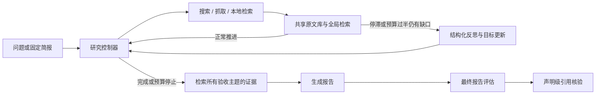

# Adaptive Deep Research Agent

有预算约束的研究 Agent：生成研究简报、动态搜索、共享原文证据、生成带引用报告，再独立评估报告。

**当前正式入口已切换为 `global_research_v2`。** 原来的静态/自适应任务轮转、按 URL 数量停止、每次阅读后全量评分不再用于在线研究。旧代码隔离在 `adra.legacy`，仅供历史合成实验复现。

本次重构参考 [Open Deep Research](https://github.com/langchain-ai/open_deep_research) 的研究循环与写作分离、[STORM](https://github.com/stanford-oval/storm) 的共享证据检索。不是这两个系统的完整复刻，也尚未证明真实任务质量提高。

## 整体流程



表格中的模块名称可跳转到下文的代码实现分析；各节同时提供源码链接。

| 模块（点击查看实现） | 主要职责 | 当前实现与边界 |
| --- | --- | --- |
| [研究简报](#module-brief) | 固定研究范围、主题与验收标准 | 初始查询是建议，不是执行队列；支持固定 JSON 与模型生成 |
| [目标与反思](#module-reflection) | 记录目标状态，提出后续查询建议 | CLI 默认事件触发，最多尝试 3 次；引文校验不代表语义判断正确 |
| [研究控制器](#module-controller) | 动态选择搜索、阅读、本地检索或结束 | 无固定任务轮转；受工具、步骤、模型调用三类预算约束 |
| [全局证据库](#module-evidence) | 共享原文、去重并保存出处 | 按规范化 URL 去重，保留正文、SHA256 和片段偏移 |
| [搜索与抓取](#module-tools) | 从外部服务获取来源及正文 | Tavily 搜索可直接返回正文；READ 仅用于已发现但未读取的 URL |
| [本地检索](#module-retrieval) | 从原文中选择与问题相关的片段 | BM25、重叠块合并、字符预算；不消耗外部工具预算，但消耗研究步骤 |
| [证据交接与写作](#module-writing) | 保留研究片段并生成带引用报告 | 交接最多 12000 字符；写作不等待评估器批准 |
| [最终评估与独立重评](#module-evaluation) | 检查最终报告是否满足验收标准 | 按主题评分，失败项有限重试；可从原运行文件重新评分 |
| [声明级引用核验](#module-verification) | 检查每条声明是否被其引用支持 | 只使用该声明引用的来源；失败记未完成，不自动改写报告 |

## 安装和配置

Python **3.11+**，无需本地 GPU/NPU；在线研究调用模型 API 与 Tavily。

```sh
uv sync --locked --extra dev --extra live
cp .env.example .env
chmod 600 .env
```

在本地编辑 `.env`，填入自己的密钥：

```dotenv
ADRA_MODEL=deepseek:deepseek-chat
DEEPSEEK_API_KEY=你的密钥
TAVILY_API_KEY=你的密钥
# 可选：不同阶段使用不同模型，未设置时继承 ADRA_MODEL
# ADRA_PLANNING_MODEL=deepseek:deepseek-chat
# ADRA_WRITING_MODEL=deepseek:deepseek-chat
# ADRA_COVERAGE_MODEL=deepseek:deepseek-chat
# ADRA_REFLECTION_MODEL=deepseek:deepseek-chat
# ADRA_VERIFICATION_MODEL=deepseek:deepseek-chat
```

`.env` 已被 Git 忽略。程序不自动加载它，在可信的自建 `.env` 上执行：

```sh
set -a
source .env
set +a
```

## 跑一个真实任务

固定简报复测 LangGraph（限制 Python 官方文档路径）：

```sh
UV_HTTP_TIMEOUT=300 uv run --locked --extra live adra \
  '根据官方文档，说明 LangGraph 的状态管理与条件路由机制' \
  --plan data/live-eval/langgraph-state-routing.json \
  --allowed-domain docs.langchain.com \
  --allowed-domain reference.langchain.com \
  --max-tools 8 --max-steps 12 --max-model-calls 32 \
  --output outputs/langgraph-v2
```

不传 `--plan` 时自动生成简报，也可显式加 `--auto-plan`。旧 `--strategy adaptive/static/baseline` 不再被正式入口接受；默认仅有 `research`。旧 `--coverage-mode sources` 已移除。`--coverage-mode none` 仅关闭验收项评分，不改变研究策略；声明核验由 `--no-verify-claims` 单独关闭。

| 参数 | 默认 | 含义 |
| --- | --- | --- |
| `--plan` | 自动生成简报 | JSON 简报，query 必须与输入一致 |
| `--allowed-domain` | 无 | 可重复指定精确主机名，与简报的路径限制取交集 |
| `--max-tools` | 6 | 外部搜索/抓取请求上限，失败请求也计数 |
| `--max-steps` | 10 | 研究行动上限，包括本地检索与被拒绝的动作 |
| `--max-model-calls` | 32 | 规划、研究、写作、评分共享的硬请求上限 |
| `--coverage-mode` | semantic | 最终评分；none 表示关闭 |
| `--reflection-mode` | event | off 基线 / event 事件触发 / always 每步触发，均受上限约束 |
| `--max-reflections` | 3 | 反思尝试次数上限，失败也计数 |
| `--reflection-context` | compact | compact 使用目标、缺口、最近三步与有限证据；full 使用研究控制器上下文 |
| `--history-window` | 6 | 模型仅接收最近 K 个动作与旧历史计数摘要 |
| `--verify-claims` | 开启 | 写作后逐声明核验；`--no-verify-claims` 关闭 |
| `--output` | outputs | 运行目录的父路径 |

研究阶段为写作保留最后一次模型调用；反思需同时留出下一次决策和写作额度。最终验收和声明核验使用剩余预算，声明较多时可提高总上限，比较实验必须使用同一上限。预算不足时 `evaluation_status=incomplete`、`semantic_coverage=null`，不是质量得分零。工具预算用尽会进入写作，写作前仍执行本地证据检索。

## 测试与评测

本地回归，不调用付费 API：

```sh
uv run --locked --extra dev --extra live pytest -q
```

真实任务批次：先检查任务清单，再实际执行。默认包含 LangGraph、Python asyncio、Pydantic 三个问题，每个问题研究一次并评估其报告。

```sh
uv run --locked --extra live python -m adra.live_evaluation
uv run --locked --extra live python -m adra.live_evaluation \
  --cases langgraph-state-routing python-asyncio pydantic-validation \
  --max-tools 8 --max-steps 12 --max-model-calls 32 --execute
```

可用 `--repeat 3` 测量波动；会按次数增加真实 API 消耗。批次保存简报副本、汇总和人工复核表。反思消融实验：

```sh
uv run --locked --extra live python -m adra.live_evaluation \
  --cases langgraph-state-routing python-asyncio pydantic-validation \
  --variants baseline event always --repeat 3
```

此命令仅预览 **27 次运行**，加 `--execute` 才调用 API。三组使用相同的修正后 BM25、简报、模型配置、工具/模型预算和最终核验；只改变反思触发方式。不是对旧提交的原样复现。每个 repeat 轮换组别顺序。`aggregate.json` 按问题和组别给出均值、样本标准差、描述性 bootstrap 区间及缺失数量；小样本区间不支持效果显著性结论。

只重评已有 v2 报告（替换为真实 run.json 路径），不需要 Tavily 请求：

```sh
uv run --locked --extra live python -m adra.report_evaluation \
  --run outputs/langgraph-v2/实际运行目录/run.json \
  --output outputs/review-v2.json --max-model-calls 48 --max-attempts 2
```

### 评估失败重试与反思上下文对照

生产覆盖评估按子任务、声明核验按声明独立尝试，默认最多两次。只重试无效输出、引用校验失败及部分暂时性请求错误；已完成的低分不会重试，认证失败和模型预算耗尽不重试。所有尝试保留 `attempts`（错误类型、阶段），失败仍计为未完成，不能当作零分。

已有 `run.json` 可以独立重评，不重新搜索或改写报告：

```bash
UV_HTTP_TIMEOUT=300 uv run --locked --extra live python -m adra.report_evaluation \
  --run outputs/你的运行目录/run.json \
  --output outputs/reevaluation-v2.json \
  --max-model-calls 48 --max-attempts 2
```

新文件保存原始输入快照、原运行文件 SHA256、评分版本、模型配置和尝试记录；输出已存在会拒绝覆盖。重评会对全部标准与声明重新评分，不挑选历史最高分。版本或模型变化后的分数应分别报告，并给 Baseline/Event 使用相同设置。48 次只是调用上限，仍可能不足，必须检查覆盖评估和声明核验两项状态。

默认反思使用 `--reflection-context compact`：原验收目标、当前缺口、最近三步、剩余预算和最多 6000 字符的证据正文；`full` 保留完整研究上下文作为对照。压缩可能丢失上下文，收益尚需真实实验验证。

先预览三个任务、每组重复三次的实验（默认不调用 API）：

```bash
uv run --locked --extra live python -m adra.live_evaluation \
  --cases langgraph-state-routing python-asyncio pydantic-validation \
  --variants baseline event event-full --repeat 3 --max-model-calls 48
```

确认预算后追加 `--execute`，共 27 次真实研究运行；只比较 Baseline/Event 则移除 `event-full`，共 18 次。`event` 是压缩反思，`event-full` 是完整上下文反思。来源数量、单次高分及未完成评分均不能证明算法收益。

本轮同时修正 RETRIEVE 查询参数优先级，以区间并集计算新增证据字符，并按原始标准及行动查询在历史完整片段间分配最终交接预算。交接仍有 12000 字符上限，并不保证保留全部证据。研究阶段不使用最终评分调度动作。

## 产物和指标

每次在输出目录中新建唯一子目录，包含：

- `report.md`：带来源 ID 的报告。
- `run.json`：原文、来源目录、配置、模型调用计量、最终状态。
- `trajectory.jsonl`：行动理由、参数、观测、工具成本，不重复存储整份证据。
- `plan.json`：不变的研究简报；priority 作为目标重要性提示，dependencies/target_sources 不控制调度。
- `goals.json` / `reflections.json`：目标状态、反思触发原因、输入及引文。
- `decisions.jsonl`：模型实际决策上下文与行动，包含 FINISH；系统指令记录在模型调用记录中。
- `claim_verification.json`：逐声明结果，完整核验才发布支持/矛盾/证据不足比例。
- `research_notes.json`：写作实际使用的片段与原文偏移。
- `evaluation.json` / `coverage.json`：报告验收结果、引文位置和失败状态。
- `failure.json`：异常类型及安全诊断，参数解析错误除外。

`semantic_coverage` 现在是**报告满足且获得原文支持的验收项比例**，不是旧版本的研究中证据覆盖率，不能直接比较。`citation_reference_validity` 仅检查引用 ID 是否存在；不代表引用内容正确。`phase_tokens` 分阶段统计消耗；未知消耗记 null。

`tool_attempts` 是 SEARCH/READ 动作数，`tool_requests_sent` 是实际调用外部适配器的次数（包括请求失败，不等同于服务商计费账单），`tool_successes` 是成功处理次数，`tool_rejections` 是请求前的本地拒绝数。`tool_calls` 仍等于外部适配器调用数。本地 RETRIEVE 仅计步骤。`new_evidence` 表示来源内容变化或出现未见过的原文字符区间；`new_characters` 按同一来源版本的区间并集计算，二者都不是语义信息增益。

## 架构范围与限制

这是以成熟模式重构的单研究者实现。没有复制 Open Deep Research 的并行 supervisor/researcher 系统，也没有复制 STORM 的多视角访谈和向量检索。

BM25 对中英术语、同义词与跨段落事实可能召回不足；片段上下文有限。控制器可能选择错误查询或提前停止，模型评分也可能误判。官方路径限制无法保证页面内不混用其他语言示例。引文位置校验只证明原文存在，不能证明语义蕴含。新增的声明核验仍是可误判的模型判断，不等于人工或独立事实真值；尚无进程中断恢复、收益预测校准或训练链路。

新架构已用可控工具和模型替身验证运行约束；真实 DeepSeek + Tavily 的质量、成本改善需要重新实测，不能由通过单测推断。

本轮根据[分享审查意见](https://chatgpt.com/share/6ad84297-89a0-83ec-bc8e-19c3fe2ffb95)落实的内容与延后事项见 [修改对照](docs/review-followup.md)。

细节见 [架构与参考](docs/architecture.md)、[真实评测](docs/live-evaluation.md)、[最终评估](docs/semantic-coverage.md)。

历史合成基线独立运行：

```sh
uv run --locked python -m adra.legacy.cli --snapshot data/demo.json
```

`adra.legacy` 不被新生产图导入；保留历史实验代码仅用于验证旧结果和建立对照，旧在线命令不再是推荐路径。

## 结合代码分析各模块实现

以下描述对应当前 `global_research_v2` / `evidence_reflection_v2` 实现。生产图由 [graph.py](src/adra/graph.py) 的 `build_graph()` 组装；[cli.py](src/adra/cli.py) 负责配置、载入或生成简报、调用 `run()` 和保存产物。下列函数中，`controller()`、`execute()`、`retrieval()`、`reflect()`、`synthesize()` 是 `build_graph()` 内部节点函数。

### 目录、模块和运行节点是三种不同的划分

当前代码是**单 Python 包内按文件划分职责**，不是每个模块一个文件夹，也不是多个独立运行的 Agent 服务。README 的九个模块是逻辑职责；LangGraph 的节点是执行阶段；文件是组织代码的单位，三者不一一对应。

```text
src/adra/
├── cli.py                  # 启动、配置检查、运行产物保存
├── configuration.py        # 各阶段模型选择、超时和请求上限
├── graph.py                # 组装研究图，同时实现多数节点逻辑
├── planning.py             # 简报及主题结构
├── research_models.py      # 研究动作结构
├── research_control.py     # 目标、反思触发、历史摘要
├── policy.py               # 各阶段模型提示、结构化调用、Token 计量
├── state.py                # Evidence / Claim / Report / Budget 等结构
├── tools.py                # Tavily 与离线快照适配器
├── domains.py              # 主机名及路径范围校验
├── evidence_store.py       # 原文入库、BM25、片段合并、写作交接
├── coverage.py             # 验收项结果结构、引文校验与重试
├── verification.py         # 逐声明核验及原文校验
├── evaluation_retry.py     # 可重试错误分类、评分版本和输入哈希
├── report_evaluation.py    # 从已有 run.json 独立重评
├── live_evaluation.py      # 固定任务、组别、重复运行与批次产物
├── experiment_summary.py   # 汇总统计与缺失值处理
├── provenance.py           # 运行环境与版本信息
└── legacy/                 # 独立隔离的旧研究调度实现
```

上面列出当前生产主链路及主要支撑文件，不是全部文件清单。`data/live-eval/` 放固定问题与简报，`tests/` 放回归测试，`docs/` 放专题文档，`outputs/` 是运行时生成的结果目录。文件名中的 evaluation 并不意味着都是同一入口；新批次入口是 `live_evaluation.py`，已有报告重评入口是 `report_evaluation.py`。

| 职责层 | 主要文件 | 决定什么 | 不承担什么 |
| --- | --- | --- | --- |
| 启动与运行配置 | `cli.py`、`configuration.py` | 读参数、选模型、创建工具、保存结果 | 不决定每轮搜索哪个问题 |
| 编排与执行 | `graph.py`、`research_control.py` | 节点路由、硬预算、反思触发、状态更新 | 不直接调用模型供应商 HTTP 接口 |
| 模型策略 | `policy.py` | 提示词、结构化输出、研究行动建议、写作与判断 | 不自行执行搜索，也不能绕过图的工具限制 |
| 数据与检索 | `state.py`、`planning.py`、`research_models.py`、`evidence_store.py` | 数据格式、原文、片段与出处 | 不把词法相关分数当作事实正确率 |
| 外部服务与范围 | `tools.py`、`domains.py` | 请求搜索/抓取、检查 URL | 不决定最终报告是否满足标准 |
| 评估与实验 | `coverage.py`、`verification.py`、两个评测入口及统计模块 | 报告评分、引用核验、可重评与组间汇总 | 不在研究中按最终评分安排下一步 |

**为什么暂时采用这种组织方式？** 一个问题目前由单研究者串行推进，文件级拆分便于追踪调用、共享同一份原文并控制 API 成本。代码中 `graph.py` 同时承担编排和节点业务、`policy.py` 同时承载多个阶段提示，因此模块边界还不完全独立。只是把文件移动到九个目录并不能消除这些耦合；未来拆包应先定义状态输入/输出、预算接口和证据合同。本次只解释现有布局，没有执行目录重构。

### 参考设计的来源与取舍

以下按本项目文档记录和本次核对的上游源码说明设计来源，不把相似的功能自动认定为代码移植。外部链接指向上游分支，可能变化；这些参考不构成同等效果的承诺。

| 来源与具体入口 | 参考的部分 | 为什么采用 | 本项目如何落地 / 没有照搬什么 |
| --- | --- | --- | --- |
| [Open Deep Research：deep_researcher.py](https://github.com/langchain-ai/open_deep_research/blob/main/src/open_deep_research/deep_researcher.py) 的 `write_research_brief`、`researcher`、`researcher_tools` | 简报驱动模型选择研究行动 | 搜索结果会改变下一步需要查什么，固定任务轮转不够灵活 | `generate_brief()` + `controller()`/`execute()`；没有 supervisor 并行分派子研究者 |
| 同文件的 `compress_research`、`final_report_generation` | 研究结果先整理，再交给写作 | 减少搜索过程与最终表达相互干扰，控制写作输入规模 | `handoff_evidence()` + `synthesize()`；使用原文选段而非模型摘要压缩 |
| [Open Deep Research：utils.py](https://github.com/langchain-ai/open_deep_research/blob/main/src/open_deep_research/utils.py) 的 `tavily_search` | 搜索携带正文并按 URL 去重 | 避免每条搜索结果都再消耗一次 READ 请求 | `include_raw_content=True` + `add_source()`；不复制逐页面模型摘要和并行搜索流程 |
| [STORM：StormInformationTable](https://github.com/stanford-oval/storm/blob/main/knowledge_storm/storm_wiki/modules/storm_dataclass.py) 的 `construct_url_to_info`、`retrieve_information` | 汇集来源后按查询取证据 | 同一来源可能回答多个主题，不应受发现顺序或任务归属限制 | `raw_documents` + 全局 `retrieve()`；不复制多视角访谈，也没有采用其 SentenceTransformer/余弦检索 |
| [rank_bm25：BM25 / BM25Okapi](https://github.com/dorianbrown/rank_bm25/blob/master/rank_bm25.py) | 真实词频统计、TF 饱和与长度归一化 | 避免把词频误写成“词是否出现”，建立可解释的检索基线 | `bm25_scores()` 自行实现；采用正 IDF，参数与该库默认值不同，不保证分数相同 |
| 本项目实验与审查反馈 | 目标状态、事件触发、硬预算、原文偏移校验、评估重试、逐声明核验 | 为 Baseline/Event 实验建立可观测、可定位的行为与失败记录 | 这些具体规则是本项目实现，不归因于 ODR 或 STORM 已有的完整方案 |

LangGraph 是本项目**直接使用的编排框架**，而不是另一个已被复刻的研究 Agent。`StateGraph(dict)`、节点和条件边由库执行；研究策略、预算规则和评分标准由本项目定义。目前 `compile()` 没有配置 checkpointer，因此使用 LangGraph 并不代表已经具备中断恢复。

### 一次运行中的调用与数据交接

```text
cli.main()
  ├─ RuntimeConfig.create_policy() → ModelPolicy（各阶段模型 + 统一调用计量）
  ├─ 固定 Plan / ModelPolicy.generate_brief()
  └─ graph.run() → build_graph().invoke(...)
       brief → researcher(controller)
                    ├─ tools(execute) → retrieve → researcher / reflect
                    ├─ reflect → researcher
                    └─ synthesize → evaluate → verify → END
```

| 状态字段 | 由谁产生/更新 | 后续谁读取 | 需要注意 |
| --- | --- | --- | --- |
| `brief`、`retrieval_queries` | `brief()`、`research_queries()` | 控制器、检索与写作 | 原标准与建议查询不是相同概念 |
| `action`、`decisions` | `controller()` | 执行器、运行审计 | 保存 FINISH 与强制停止原因 |
| `evidence`、`raw_documents` | `execute()` 调用 `add_source()` | 检索、写作、最终核验 | 目录预览与原始正文分别存储 |
| `notes`、`seen_passages` | `retrieval()` | 下一轮决策、反思、增量统计 | notes 是当前选段，seen_passages 是历史区间记录 |
| `evidence_memory` | `retrieval()` 追加 | `synthesize()` | 是片段历史，不是跨进程持久化记忆 |
| `goals`、`reflections` | `brief()`、`reflect()` | 控制器与触发规则 | 是暂定研究判断，不是最终报告评分 |
| `report`、`research_notes` | `synthesize()` | 评估、核验与产物保存 | 后者记录写作真实输入，但尚未强制贯穿所有评估输入 |
| `coverage`、`claim_verification` | `evaluate_report()`、`verify_report()` | 指标计算、批次汇总 | 不回写为研究中的目标状态 |

例如，搜索拿到 `graph-api` 正文后，执行器将它保存为来源 E1；RETRIEVE 只在原文库中重新选段，并记录起止偏移；写作把 E1 作为声明引用；覆盖评估按验收项检索，而声明核验只在该声明引用的来源中检索。最后两种检索的输入不同，正是目前可能出现“同一事实评分不一致”的具体位置，不能只通过改提示词掩盖。

<a id="module-brief"></a>

### [研究简报](src/adra/planning.py)

**代码入口：** [planning.py](src/adra/planning.py) 的 `Plan`、`SubTask`，以及 [policy.py](src/adra/policy.py) 的 `ModelPolicy.generate_brief()`。

`Plan` 保存原问题、主题列表和允许的 URL 路径前缀；每个主题包含描述、初始查询和 `criteria`。验收项由 [coverage.py](src/adra/coverage.py) 的 `Criterion` 定义，其中 `retrieval_terms` 用于补充英文术语和 API 名称，帮助中文问题检索英文文档。Pydantic 校验负责拒绝重复 ID、重复查询、未知依赖和循环依赖。

CLI 先加载固定计划，或调用模型生成计划，再启动研究图。`brief()` 把计划保存到状态；`research_queries()` 将验收描述与检索词组成全局查询。这样将“需要回答什么”与“下一步执行什么”分开。`dependencies` 和 `target_sources` 仍接受格式校验，但只是兼容字段，不构成生产调度队列；`priority` 只作为目标重要性提示。

**文件之间怎样配合：**

| 调用/结构 | 输入 → 输出 | 这里负责的约束 |
| --- | --- | --- |
| `cli.main()` | 命令行问题、可选计划文件 → `Plan` | 选择固定计划或自动简报路径，检查问题一致性 |
| `Plan` / `SubTask` / `Criterion` | JSON 或模型结果 → 校验后的结构 | ID、查询、路径与验收项格式 |
| `ModelPolicy.generate_brief()` | 问题、预算 → 结构化简报 | 提示模型保持语言/版本范围，给出可观察的验收项 |
| `graph.brief()` | 已有计划 → 图状态中的 brief、目标、检索查询 | 初始化运行；不是再次调用模型规划 |

**参考与原因：** 参考 Open Deep Research 的 `write_research_brief` 阶段，把模糊问题转换为后续研究的稳定输入，具体来源见上方参考表。本项目进一步把验收项结构化，方便固定计划复测；没有实现其用户澄清流程和 supervisor 初始化。固定简报也不能保证标准合理，需要人工检查是否要求了超出原问题的细节。

<a id="module-reflection"></a>

### [目标与反思](src/adra/research_control.py)

**代码入口：** [research_control.py](src/adra/research_control.py) 的 `initial_goals()`、`reflection_trigger()`、`update_goals()`，以及 [graph.py](src/adra/graph.py) 的 `reflect()`。

`initial_goals()` 将验收项映射为目标，记录原始描述、状态、缺失事实与引用。`reflection_trigger()` 在连续两步没有新证据、预算过半仍有缺口、准备结束但有缺口或模型报告冲突等情况下判断是否反思；同时检查次数、同一步重复触发和模型额度。`always` 在满足预算与次数条件时每步触发，`off` 关闭反思。CLI 默认 `event`，直接使用 Python `ResearchOptions()` 则默认 `off`。

`reflect()` 的 compact 模式传入目标、缺口、最近三步、剩余工具/步骤预算，以及最多 6000 字符的检索证据正文；full 模式使用控制器上下文。模型返回 `ReflectionResult`，`update_goals()` 校验目标 ID、引文和状态约束，再更新目标。失败保留原目标，并记录是请求阶段还是目标引文校验阶段失败。

这种设计让研究可以调整方向，又不直接使用最终报告评分控制搜索。但 `missing_facts` 仍由模型生成，可能追加原标准没有要求的细节；代码保持了目标描述不变，并不等于已经解决标准扩张。compact 的证据选择也可能遗漏先前找到的支持段落。

**触发与执行不是同一个函数：** `reflection_trigger()` 只返回触发原因或 None，不请求模型；`reflect()` 负责准备上下文、调用模型、验证更新和保存失败。`update_goals()` 要求每个原目标恰好出现一次；supported 不能同时有缺失事实，conflicted 至少需要两条不同引文。`invalidate_stale_goals()` 在来源哈希改变后使引用旧正文的目标失效。

**参考与原因：** ODR 的 [think_tool](https://github.com/langchain-ai/open_deep_research/blob/main/src/open_deep_research/utils.py) 也提供研究中的反思入口，但这里仅作机制对照。本项目的“连续两步”“半程”“带引文的目标状态”“最多三次”等规则来自自身实验设计，不是移植它的策略。把触发器与模型反思分开，是为了让 off/event/always 的差别可检查、可消融；是否有效仍需实测。

对应回归入口：[test_review_changes.py](tests/test_review_changes.py) 检查触发条件、预算保留、目标引用和反思失败。它验证程序规则，不证明反思建议正确。

<a id="module-controller"></a>

### [研究控制器](src/adra/graph.py)

**代码入口：** [graph.py](src/adra/graph.py) 的 `context()`、`controller()`、`execute()`，动作结构见 [research_models.py](src/adra/research_models.py)。

每次决策前，`context()` 汇总问题、简报、来源目录、当前片段、目标状态、最近反思和有限历史。来源目录最多 30 条，旧动作转换为计数摘要。`controller()` 先检查硬预算；尚有额度时调用 `policy.research()`，返回 `SEARCH`、`READ`、`RETRIEVE` 或 `FINISH`。反思可以在模型准备结束时介入一次新的决策，因此 FINISH 不一定立即进入写作。

`execute()` 检查重复动作、来源范围和页面读取状态，执行后写入 `transitions`。外部请求与研究步骤分别计量：本地检索及被拒绝动作仍消耗步骤，实际搜索/抓取才计外部请求。模型调用上限由 [policy.py](src/adra/policy.py) 的 `_invoke()` 统一执行，研究控制器为写作保留一次调用。

控制器使用模型推断下一步，而不是固定轮转主题。灵活性也带来局限：它可能过早判断完成，或反复改写同一检索请求；当前重复动作检查不能识别所有语义相近的查询。

**一次决策的职责顺序：**

1. `controller()` 判断是否已耗尽步骤、工具或需为写作保留最后一次模型额度。
2. 未强制停止时，`ModelPolicy.research()` 返回 `ResearchDecision`，包含 kind、argument、focus、reason 和疑似冲突标记。
3. 条件边根据待反思标记和 FINISH 决定下一节点；其余动作进入 `execute()`。
4. 执行器先做范围和重复检查，再调用工具，最后更新计数与观测；新的观测交给下一轮模型。

**参考与原因：** 参考 ODR 的 `researcher` / `researcher_tools` 循环，让模型根据观测调整查询，而由程序负责执行边界。本项目没有采用它的多研究者调度：当前单研究者更容易对齐预算与追踪一次反思后的行为，但缺少并行探索和相互隔离的主题上下文。

这里的“控制器”不是单独模型服务，`graph.py` 内的控制逻辑和 `policy.py` 内的模型决策共同实现它。将二者分开允许测试用模型替身重放动作序列；主要回归入口为 [test_global_research.py](tests/test_global_research.py)。

<a id="module-evidence"></a>

### [全局证据库](src/adra/evidence_store.py)

**代码入口：** [evidence_store.py](src/adra/evidence_store.py) 的 `add_source()`，URL 规范化见 [tools.py](src/adra/tools.py) 的 `canonical_url()`。

证据分为 `evidence` 来源目录和 `raw_documents` 原文存储。`add_source()` 按规范化 URL 查找或创建 E1、E2 等 ID，分别保存搜索片段和读取正文；搜索结果不能覆盖已有完整正文。来源目录保存正文哈希、长度、读取标记和短预览，模型无需每次接收整页原文。

检索面向全部已读取来源，不按来源最初属于哪个主题过滤。这允许同一页面支持多个主题。SHA256 和字符偏移用于检查引用是否对应保存的原文；它们只能证明文本一致，不能证明结论正确。若同一 URL 的正文更新，当前内容和哈希也会更新，这不是保存所有版本的文档数据库。

**保存的三种视图不能混用：**

| 视图 | 内容 | 用途 |
| --- | --- | --- |
| `evidence[id]` 对应的来源条目 | ID、URL、标题、短预览、正文哈希等；实际容器是列表 | 决策时浏览来源目录 |
| `raw_documents[id]['read']` | 抓取/搜索返回的正文字符串 | 重新检索与校验原文 |
| 检索结果的 `passages` | start、end、text | 限制模型输入，同时保留回到原文的位置 |

**参考与原因：** 借鉴 STORM `StormInformationTable` 汇集和去重来源、再面向查询取信息的做法。它解决的是信息共享边界：由主题 A 找到的文档也可能支持主题 B。本项目另外增加全文哈希和字符偏移用于审计；不能把这些校验能力归为 STORM 已被照搬的实现。

当前原文驻留运行内存并随 run.json 保存，不是外部数据库；整个图状态也没有完整的强类型 schema。来源 ID 仅在单次运行内解释，跨运行比较应结合 URL、正文哈希和问题配置。

<a id="module-tools"></a>

### [搜索与抓取](src/adra/tools.py)

**代码入口：** [tools.py](src/adra/tools.py) 的 `TavilyTools.search()`、`read()`，范围校验见 [domains.py](src/adra/domains.py) 的 `DomainPolicy`。

生产 CLI 启用搜索正文返回。`execute()` 最多处理五条搜索结果：有非空 `raw_content` 就作为已读正文入库；只有摘要时保存为未读来源，后续可以 READ。READ 调用 Tavily extract，且仅允许访问已收集的 URL；已读页面会返回 `already_read_use_retrieve`。

`DomainPolicy` 将精确主机名与计划路径前缀取交集；执行器重新检查搜索返回 URL，抓取适配器检查返回 URL，避免仅依赖服务商过滤。适配器没有隐式重试，一次实际请求对应一次工具预算消耗，失败请求也计数。

路径约束有助于限定 Python 官方文档，但无法证明页面正文只含 Python，也无法排除允许路径下与问题无关的页面。

**适配器与执行器的边界：** `TavilyTools` 负责 HTTP 请求和返回内容，`execute()` 负责这次动作是否允许、消耗多少预算、来源如何入库。测试可将 Tavily 替换成 `SnapshotTools`；快照中没有对应查询时明确报错，而不是返回其他查询的结果。

**参考与原因：** 参考 ODR `tavily_search` 的正文返回与 URL 去重路径，以减少“先搜索、再逐页阅读”的请求数。但本项目保留原文供后续检索，没有接入 ODR 的逐页摘要模型；这是为了减少额外模型成本并保留可核对的引文位置。主机名/路径交集、请求前拒绝计量是本项目的约束实现。

测试位置：[test_domains.py](tests/test_domains.py) 检查范围规则，[test_adapters.py](tests/test_adapters.py) 与 [test_global_research.py](tests/test_global_research.py) 检查适配器和执行链路。

<a id="module-retrieval"></a>

### [本地检索](src/adra/evidence_store.py)

**代码入口：** [evidence_store.py](src/adra/evidence_store.py) 的 `tokenize()`、`bm25_scores()`、`retrieve()`、`merge_spans()`，观测更新位于 [graph.py](src/adra/graph.py) 的 `retrieval()`。

正文按 1200 字符切块、900 字符步长滑动。分词保留英文/API 标识符词频，对中文生成相邻双字；BM25 使用 `k1=1.2`、`b=0.75` 和正 IDF。每个查询默认取前四个正分候选，跨查询轮流分配字符预算，并合并同页重叠区间。结果保留来源 ID、哈希、原文起止偏移与片段文本。

`retrieval()` 对 RETRIEVE 优先使用动作的 `argument`，再加入简报查询，避免被概括性的 `focus` 替代。每次观测记录查询、来源 ID、片段数和 `new_characters`；新增字符按相同来源哈希下的区间并集计算，避免仅因块边界改变就算新增证据。

这种词法检索成本可控，且不需要向量模型。但它不理解语义蕴含，新增字符也不意味着解决了缺失标准。反复改写查询仍可能只找到相邻但无用的段落。

**函数分工：** `tokenize()` 决定词项；`bm25_scores()` 只算候选分数，不读网络；`retrieve()` 决定切块、每个查询候选与总预算；`merge_spans()` 防止重叠正文重复占空间；图节点 `retrieval()` 才负责更新运行历史和新增字符。这些函数处于同一文件，是因为当前共同操作同一份原文和片段结构，并不意味着检索与存储已经拥有独立接口。

**参考与原因：** 参考 `rank_bm25` 的词频和长度处理建立词法基线；本项目窗口、中文双字词、字符预算、多查询轮流分配是自己的实现。相比 STORM 的向量检索，这里暂不引入编码器，便于在无本地加速卡时运行并检查 API 标识符匹配。代价是同义词和跨语言召回较弱；这是一项工程取舍，不是已证明 BM25 优于向量检索。

回归入口：[test_evaluation_repairs.py](tests/test_evaluation_repairs.py) 检查查询参数优先级与重复正文计量，[test_review_changes.py](tests/test_review_changes.py) 检查 BM25 与区间处理。

<a id="module-writing"></a>

### [证据交接与写作](src/adra/graph.py)

**代码入口：** [graph.py](src/adra/graph.py) 的 `synthesize()`、[evidence_store.py](src/adra/evidence_store.py) 的 `handoff_evidence()`，报告结构见 [state.py](src/adra/state.py) 的 `Report`、`Claim`。

研究中的检索结果进入 `evidence_memory`。写作前，`synthesize()` 汇总简报查询和有效 RETRIEVE 查询，再把新检索结果与历史片段交给 `handoff_evidence()`。后者校验哈希与原文位置，按查询排序、轮流选择完整片段并合并重叠区间，总交接预算为 12000 字符。

`policy.write()` 接收问题、证据、研究范围和停止原因，返回声明与局限。写作不接收最终覆盖评分；图节点检查每条声明引用的 ID 是否来自交接证据。没有可引用正文时，生成无事实声明的局限报告。实际交接保存在 `research_notes.json`，可用于排查“原文里有、报告里没写”的问题。

保留完整历史片段能降低重新切块造成的证据丢失，但预算仍会淘汰部分内容。目前声明保存来源 ID，没有直接绑定写作时的逐声明原文区间；这是后续核验出现证据不一致的一个环节。

**从研究状态到报告的接口：** `handoff_evidence()` 接收来源目录、原文、历史片段批次和查询列表，返回可引用片段；`synthesize()` 再构造 write 输入；`ModelPolicy.write()` 返回 `Report`，每个 `Claim` 只包含 text 和 evidence_ids。`cli.py` 将结构化结果渲染为 Markdown，因此报告文件不是模型直接写入磁盘的。

**参考与原因：** 借鉴 ODR `compress_research` 后接 `final_report_generation` 的阶段分离。此处用确定性的原文选段替代模型摘要：可以核验偏移，减少压缩时引入新说法，也节省一次摘要调用。但原文包含导航、示例和重复内容，相同字符预算未必比高质量摘要覆盖更多事实。

写作中的来源 ID 检查只保证“引用属于提供的来源”，不保证整条声明被其支持。因此必须把来源合法性、引文原文存在性和语义支持三个层次分开观察。

<a id="module-evaluation"></a>

### [最终评估与独立重评](src/adra/report_evaluation.py)

**代码入口：** [graph.py](src/adra/graph.py) 的 `evaluate_report()`、[coverage.py](src/adra/coverage.py) 的 `refresh_coverage()`；独立入口为 [report_evaluation.py](src/adra/report_evaluation.py)，版本与重试规则见 [evaluation_retry.py](src/adra/evaluation_retry.py)。

报告生成后，`evaluate_report()` 按每个主题的验收项从原文库独立检索，证据预算为每主题 8000 字符，再调用 `policy.assess_report()`。`refresh_coverage()` 校验是否恰好覆盖原标准、状态与引文是否一致、引用是否存在于提供的片段中。生产入口默认每个主题最多尝试两次，只重试符合条件的失败，不重试有效低分。

完整评分后，`semantic_coverage` 等于 supported 验收项数除以全部验收项数；partial 不计为完整覆盖。有失败时保留未完成，整体指标为 null。独立重评直接读取旧 `run.json`，不搜索、不写新报告，也不覆盖原文件；新产物保留输入快照、哈希、评分版本、模型配置和调用记录。

**已知限制：** 覆盖评估目前重新选择片段，没有保证继承写作实际采用的相关原文。最近两组 LangGraph 运行中，写作证据包含路由说明，评估片段却遗漏它并给出 partial。评分完成不等于评分可靠；此问题尚未修复，不能据当前分数直接宣称策略收益。

**为什么分为三个文件：** `graph.evaluate_report()` 决定生产流程何时评估以及给评估器哪些证据；`coverage.py` 定义判断格式、逐项校验和失败重试；`report_evaluation.py` 负责读取冻结的运行文件并保存新评估，不启动研究图。`evaluation_retry.py` 提供共享错误分类与哈希版本，避免核验与覆盖评估各自定义不一致的重试口径。

**设计来源与原因：** 这里没有把最终评估实现标为 ODR 或 STORM 的直接移植。按固定标准评分、有效低分不重试、失败不填零、独立重评，是为本项目实验可比性增加的机制。研究与评分分离是流程隔离，不意味着评估模型与写作模型天然独立；默认可能使用同一个模型，也没有独立人工真值保证。

`live_evaluation.py` 在外层冻结计划、轮换组别次序并收集多次运行；`experiment_summary.py` 处理均值、缺失值和描述性区间。测试可验证统计计算和预算行为，却不能证明评分标尺正确，仍需要人工复核样例。

<a id="module-verification"></a>

### [声明级引用核验](src/adra/verification.py)

**代码入口：** [verification.py](src/adra/verification.py) 的 `verify_report()`、`validate_quotes()`，模型提示位于 [policy.py](src/adra/policy.py) 的 `verify_claim()`。

核验逐条读取报告声明，只保留它实际引用的来源，按声明文本检索最多 6000 字符证据。模型输出 supported、contradicted 或 insufficient；支持或矛盾结论必须附原文引文，再经过哈希与位置校验。无可用引用证据时记录 insufficient；请求或校验失败则保留未完成，每条声明默认最多尝试两次。

所有声明完成核验后才发布支持、矛盾和证据不足比例，否则这些比例为 null。核验结果附在报告后，不自动修改原声明，也不代表人工认证。

**已知限制：** 只有检索完全无结果时才回退到写作片段；如果检索命中了不充分的段落，现有逻辑不会自动补回写作证据。因此“引用原文存在，但核验没看到”仍可能造成 insufficient。下一步应先修复证据输入，再校准模型判断，而不是把所有低分都当成报告错误。

**核验顺序：** 取声明引用的来源 → 选择片段 → 请求 `ClaimVerdict` → `validate_quotes()` 核对原文哈希和偏移 → 保存逐次尝试 → 所有声明结束后汇总比例。未引用的文档即使有支持内容，也不会自动为该声明“补引用”；这让指标衡量实际引用质量，而不是整个语料库有没有答案。

**设计来源与原因：** 三分类核验和引文位置校验是本项目为补足“引用 ID 存在但内容不支持”问题实现的。没有证据表明这里完整采用了某个成熟研究系统的事实核验方案，因此不将其包装为 ODR/STORM 的现成能力。与最终覆盖评估分别保留，是因为“问题答全了没有”与“写出的声明有没有证据”是两个不同问题。

例如，报告只写出一个被支持的事实，支持率可以很高但覆盖率很低；反之，报告提到了所有验收点，却可能给出错误或不足的引用。两项指标必须并列，且都受模型判断和证据选择影响。对应失败重试和证据交接测试见 [test_evaluation_repairs.py](tests/test_evaluation_repairs.py)。

## 后续优化

以下为待实施事项，本次仅整理文档，没有修改程序行为。先修复评估可靠性与研究停滞，再扩大对照实验。

| 优先级 | 优化部分 | 当前问题 | 拟实施方向 | 验收方式 |
| --- | --- | --- | --- | --- |
| P0 | [写作到评估的证据交接](#module-evaluation) | 独立检索可能漏掉写作已使用的支持段落 | 保存逐声明证据位置；将相关写作片段与独立检索结果合并，继续验证哈希和出处 | 固定语料回归中，路由与部分更新原文对相应核验可见；保持总输入预算 |
| P0 | [声明核验一致性](#module-verification) | 检索非空但不充分时，没有补充原写作证据 | 区分证据选择不足和模型判定；使用统一的可追溯证据输入 | 人工复核同一事实在覆盖评估和声明核验中的差异；不以强制同分替代正确性 |
| P1 | [检索停滞与停止决策](#module-controller) | 新增字符不等于补齐缺口，近似查询反复消耗步骤 | 记录缺口、相近查询与命中段落变化；停滞时切换外部搜索或带局限结束 | 比较后半程无效动作、Token、报告覆盖与支持率，防止仅靠提前停止降低成本 |
| P1 | [反思标准约束](#module-reflection) | 模型生成的 missing_facts 可能扩张验收要求 | 建立缺口与原始验收项的对应关系；将额外细节作为可选建议 | 固定样例检查是否追加原问题未要求的字符串值、校验机制等条件 |
| P1 | [决策上下文成本](#module-controller) | Event 的主要 Token 消耗可能来自多轮决策，而非反思本身 | 去掉重复正文，按待解决问题选择上下文，保留必要历史与出处 | 在相同模型和预算下比较 decision 阶段 Token、失败率和质量；避免压缩后丢证据 |
| P2 | [真实任务对照实验](#module-evaluation) | 目前单任务、单次样本不足以证明收益 | 修复后先重评同一批旧报告，再运行 3～5 个任务、每组至少 3 次 | 保持模型、计划、预算和评分版本一致；同时报告未完成比例、成本与人工复核结果 |
| P2 | [检索与运行扩展](#module-retrieval) | BM25 跨语言召回有限，长任务缺少中断恢复 | 根据多任务错误分布决定是否增加混合检索、重排与持久化恢复 | 通过单独消融验证新增模块的收益和额外成本，不预设必须增加复杂度 |

当前阶段的目标是让研究结果可追溯、评分可信、成本可比较。只有在评估完整且标准一致的多任务重复实验中，才能进一步判断 Event Reflection 是否优于 Baseline。
