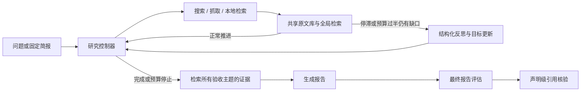

# Adaptive Deep Research Agent

有预算约束的研究 Agent：生成研究简报、动态搜索、共享原文证据、生成带引用报告，再独立评估报告。

**当前正式入口已切换为 `global_research_v2`。** 原来的静态/自适应任务轮转、按 URL 数量停止、每次阅读后全量评分不再用于在线研究。旧代码隔离在 `adra.legacy`，仅供历史合成实验复现。

本次重构参考 [Open Deep Research](https://github.com/langchain-ai/open_deep_research) 的研究循环与写作分离、[STORM](https://github.com/stanford-oval/storm) 的共享证据检索。不是这两个系统的完整复刻，也尚未证明真实任务质量提高。

## 整体流程



- **研究简报**规定范围与验收标准，初始查询仅是建议，不是必须执行的队列。
- **目标与反思**：验收标准保持不变，另外记录 unexplored/partial/supported/conflicted 目标状态。CLI 默认事件触发反思，最多 3 次；状态来自模型判断及原文引文校验，不等于真实正确性。
- **研究控制器**根据发现生成新查询、选择未读来源、换关键词检索已有原文，或结束。没有按任务轮转的固定规则。
- **全局证据库**按 URL 去重、保留正文和 SHA256；任何主题都能检索全部已读取原文，发现来源的任务不再决定可见性。
- **搜索**请求 Tavily 同时返回正文，有正文即入库，无正文才需要 READ。一次工具调用对应一次外部请求。
- **检索**使用保留真实词频的 BM25（k1=1.2、b=0.75、正 IDF），合并重叠文本块并保留字符偏移。`RETRIEVE` 不消耗外部工具预算，但消耗研究步骤；不是向量检索。
- **写作**只引用从已读取原文中选出的片段，不依赖评估器先行批准。
- **最终评估**在报告完成后按主题执行一次，检查报告是否回答验收项及原文支持；失败不丢失报告。可单独重评，无须重新搜索。

- **声明核验**只检查每条声明实际引用的来源，输出 supported/contradicted/insufficient；模型失败或预算不足保留未完成。不会自动修改报告。

## 安装和配置

Python **3.11+**，无需本地 GPU/NPU；在线研究调用模型 API 与 Tavily。

```sh
uv sync --locked --extra dev --extra live
cp .env.example .env
chmod 600 .env
```

在本地编辑 `.env`，填入自己的密钥：

```dotenv
ADRA_MODEL=deepseek:deepseek-chat
DEEPSEEK_API_KEY=你的密钥
TAVILY_API_KEY=你的密钥
# 可选：不同阶段使用不同模型，未设置时继承 ADRA_MODEL
# ADRA_PLANNING_MODEL=deepseek:deepseek-chat
# ADRA_WRITING_MODEL=deepseek:deepseek-chat
# ADRA_COVERAGE_MODEL=deepseek:deepseek-chat
# ADRA_REFLECTION_MODEL=deepseek:deepseek-chat
# ADRA_VERIFICATION_MODEL=deepseek:deepseek-chat
```

`.env` 已被 Git 忽略。程序不自动加载它，在可信的自建 `.env` 上执行：

```sh
set -a
source .env
set +a
```

## 跑一个真实任务

固定简报复测 LangGraph（限制 Python 官方文档路径）：

```sh
UV_HTTP_TIMEOUT=300 uv run --locked --extra live adra \
  '根据官方文档，说明 LangGraph 的状态管理与条件路由机制' \
  --plan data/live-eval/langgraph-state-routing.json \
  --allowed-domain docs.langchain.com \
  --allowed-domain reference.langchain.com \
  --max-tools 8 --max-steps 12 --max-model-calls 32 \
  --output outputs/langgraph-v2
```

不传 `--plan` 时自动生成简报，也可显式加 `--auto-plan`。旧 `--strategy adaptive/static/baseline` 不再被正式入口接受；默认仅有 `research`。旧 `--coverage-mode sources` 已移除。`--coverage-mode none` 仅关闭验收项评分，不改变研究策略；声明核验由 `--no-verify-claims` 单独关闭。

| 参数 | 默认 | 含义 |
| --- | --- | --- |
| `--plan` | 自动生成简报 | JSON 简报，query 必须与输入一致 |
| `--allowed-domain` | 无 | 可重复指定精确主机名，与简报的路径限制取交集 |
| `--max-tools` | 6 | 外部搜索/抓取请求上限，失败请求也计数 |
| `--max-steps` | 10 | 研究行动上限，包括本地检索与被拒绝的动作 |
| `--max-model-calls` | 32 | 规划、研究、写作、评分共享的硬请求上限 |
| `--coverage-mode` | semantic | 最终评分；none 表示关闭 |
| `--reflection-mode` | event | off 基线 / event 事件触发 / always 每步触发，均受上限约束 |
| `--max-reflections` | 3 | 反思尝试次数上限，失败也计数 |
| `--history-window` | 6 | 模型仅接收最近 K 个动作与旧历史计数摘要 |
| `--verify-claims` | 开启 | 写作后逐声明核验；`--no-verify-claims` 关闭 |
| `--output` | outputs | 运行目录的父路径 |

研究阶段为写作保留最后一次模型调用；反思需同时留出下一次决策和写作额度。最终验收和声明核验使用剩余预算，声明较多时可提高总上限，比较实验必须使用同一上限。预算不足时 `evaluation_status=incomplete`、`semantic_coverage=null`，不是质量得分零。工具预算用尽会进入写作，写作前仍执行本地证据检索。

## 测试与评测

本地回归，不调用付费 API：

```sh
uv run --locked --extra dev --extra live pytest -q
```

真实任务批次：先检查任务清单，再实际执行。默认包含 LangGraph、Python asyncio、Pydantic 三个问题，每个问题研究一次并评估其报告。

```sh
uv run --locked --extra live python -m adra.live_evaluation
uv run --locked --extra live python -m adra.live_evaluation \
  --cases langgraph-state-routing python-asyncio pydantic-validation \
  --max-tools 8 --max-steps 12 --max-model-calls 32 --execute
```

可用 `--repeat 3` 测量波动；会按次数增加真实 API 消耗。批次保存简报副本、汇总和人工复核表。反思消融实验：

```sh
uv run --locked --extra live python -m adra.live_evaluation \
  --cases langgraph-state-routing python-asyncio pydantic-validation \
  --variants baseline event always --repeat 3
```

此命令仅预览 **27 次运行**，加 `--execute` 才调用 API。三组使用相同的修正后 BM25、简报、模型配置、工具/模型预算和最终核验；只改变反思触发方式。不是对旧提交的原样复现。每个 repeat 轮换组别顺序。`aggregate.json` 按问题和组别给出均值、样本标准差、描述性 bootstrap 区间及缺失数量；小样本区间不支持效果显著性结论。

只重评已有 v2 报告（替换为真实 run.json 路径），不需要 Tavily 请求：

```sh
uv run --locked --extra live python -m adra.report_evaluation \
  --run outputs/langgraph-v2/实际运行目录/run.json \
  --output outputs/review-v2.json --max-model-calls 8
```

## 产物和指标

每次在输出目录中新建唯一子目录，包含：

- `report.md`：带来源 ID 的报告。
- `run.json`：原文、来源目录、配置、模型调用计量、最终状态。
- `trajectory.jsonl`：行动理由、参数、观测、工具成本，不重复存储整份证据。
- `plan.json`：不变的研究简报；priority 作为目标重要性提示，dependencies/target_sources 不控制调度。
- `goals.json` / `reflections.json`：目标状态、反思触发原因、输入及引文。
- `decisions.jsonl`：模型实际决策上下文与行动，包含 FINISH；系统指令记录在模型调用记录中。
- `claim_verification.json`：逐声明结果，完整核验才发布支持/矛盾/证据不足比例。
- `research_notes.json`：写作实际使用的片段与原文偏移。
- `evaluation.json` / `coverage.json`：报告验收结果、引文位置和失败状态。
- `failure.json`：异常类型及安全诊断，参数解析错误除外。

`semantic_coverage` 现在是**报告满足且获得原文支持的验收项比例**，不是旧版本的研究中证据覆盖率，不能直接比较。`citation_reference_validity` 仅检查引用 ID 是否存在；不代表引用内容正确。`phase_tokens` 分阶段统计消耗；未知消耗记 null。

`tool_attempts` 是 SEARCH/READ 动作数，`tool_requests_sent` 是实际调用外部适配器的次数（包括请求失败，不等同于服务商计费账单），`tool_successes` 是成功处理次数，`tool_rejections` 是请求前的本地拒绝数。`tool_calls` 仍等于外部适配器调用数。本地 RETRIEVE 仅计步骤。`new_evidence` 只表示来源/片段变化，不是语义信息增益。

## 架构范围与限制

这是以成熟模式重构的单研究者实现。没有复制 Open Deep Research 的并行 supervisor/researcher 系统，也没有复制 STORM 的多视角访谈和向量检索。

BM25 对中英术语、同义词与跨段落事实可能召回不足；片段上下文有限。控制器可能选择错误查询或提前停止，模型评分也可能误判。官方路径限制无法保证页面内不混用其他语言示例。引文位置校验只证明原文存在，不能证明语义蕴含。新增的声明核验仍是可误判的模型判断，不等于人工或独立事实真值；尚无进程中断恢复、收益预测校准或训练链路。

新架构已用可控工具和模型替身验证运行约束；真实 DeepSeek + Tavily 的质量、成本改善需要重新实测，不能由通过单测推断。

本轮根据[分享审查意见](https://chatgpt.com/share/6ad84297-89a0-83ec-bc8e-19c3fe2ffb95)落实的内容与延后事项见 [修改对照](docs/review-followup.md)。

细节见 [架构与参考](docs/architecture.md)、[真实评测](docs/live-evaluation.md)、[最终评估](docs/semantic-coverage.md)。

历史合成基线独立运行：

```sh
uv run --locked python -m adra.legacy.cli --snapshot data/demo.json
```

`adra.legacy` 不被新生产图导入；保留历史实验代码仅用于验证旧结果和建立对照，旧在线命令不再是推荐路径。
