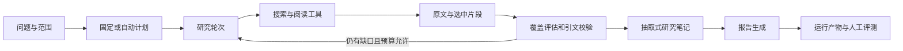

# 研究 Agent 架构与参考依据

查阅日期：2026-10-20。本文区分外部实现、项目中的适配、仍未实现的功能。
参考开源项目不代表已复现其效果；当前交付目标是可运行、可审计、可批量评测的 CLI 研究 Agent。

## 参考系统

- [LangChain Open Deep Research 主图](https://github.com/langchain-ai/open_deep_research/blob/main/src/open_deep_research/deep_researcher.py)：研究范围、监督器、研究者循环、压缩和报告分开。
- [工具实现](https://github.com/langchain-ai/open_deep_research/blob/main/src/open_deep_research/utils.py)：Tavily 搜索可取得正文，去重后整理页面，再返回研究结果。
- [状态定义](https://github.com/langchain-ai/open_deep_research/blob/main/src/open_deep_research/state.py)：原始笔记、压缩笔记与最终报告分离。
- [配置](https://github.com/langchain-ai/open_deep_research/blob/main/src/open_deep_research/configuration.py)：分阶段模型与迭代、输出限制。
- [提示词](https://github.com/langchain-ai/open_deep_research/blob/main/src/open_deep_research/prompts.py)：明确范围、研究过程与压缩输出要求。
- [Anthropic：构建多代理研究系统](https://www.anthropic.com/engineering/multi-agent-research-system)：任务边界、上下文压缩、可观测性与评估。
- [Anthropic：Building effective agents](https://www.anthropic.com/engineering/building-effective-agents)：从可组合的简单工作流开始，按需要增加复杂度。
- [Stanford STORM 官方仓库](https://github.com/stanford-oval/storm)与[NAACL 2024 论文](https://aclanthology.org/2024.naacl-long.347/)：资料搜集/整理与带引用写作分阶段。这里借鉴两阶段边界；未实现其多视角问题生成、模拟访谈或长文章提纲系统。

链接指向当时查阅的公开页面/main，不是永久固定版本；这里借鉴架构原则，没有复制上游实现。

## 模块对应与实现



| 模块 | 参考做法 | 本项目实现 | 边界 |
| --- | --- | --- | --- |
| 输入与研究范围 | 先明确研究 brief | query + Plan + criteria + 域名/路径范围；固定计划或自动规划 | 不做多轮用户澄清；需在 query/plan 写清语言版本 |
| Planner | 结构化任务分解、明确迭代界限 | `planning.py` DAG 校验、依赖、预算检查；`policy.py` 自动规划最多两次 | 动态任务图重写未实现 |
| 研究执行 | 研究单元完成工具工作后交还控制 | `graph.py`、`planning.py`：成功搜索后从本次结果阅读一页，再回到任务分配 | 顺序执行；不启动并发子代理 |
| 检索与范围 | 工具负责获取可用来源 | `tools.py` Tavily / Snapshot；`domains.py` 域名与 URL 路径检查 | 未披露跳转、页面正文语言不能靠路径完全判断 |
| 证据管理 | 原始内容与整理结果分离 | `passages.py` 全文选段；保存原文、偏移、hash；`coverage.py` 原句校验 | 词法选段；未实现向量库与自动缺口重选 |
| 研究笔记 | 压缩后交给 Writer | `research_notes()` 提取已读、已校验引文，保留 partial/missing | 是抽取式压缩，不是独立事实裁判 |
| 报告 | 根据研究结果综合报告 | semantic Writer 只接收笔记；程序拒绝引用笔记以外的来源 | 无法仅凭来源 ID 验证整句事实蕴含 |
| 配置与限额 | 各阶段独立模型与调用界限 | `configuration.py` 分阶段模型；工具/步骤/模型请求上限、逐请求超时 | 无总金额/总 token 硬预算；无持久化中途恢复 |
| 可观测性 | 保存研究过程与阶段产物 | run、trajectory、plan、coverage、research_notes、failure、调用用量 | 原始产物可能较大 |
| 评测 | 固定输入、多次运行、质量与成本分开 | `live_evaluation.py` 固定计划配对批次、失败保留、人工复核表；原合成比较器保留 | 人工复核仍需实际执行；不能用自评冒充独立评测 |

## 搜索—阅读研究轮次

本项目仍分别记录 SEARCH 和 READ，分别收费、分别扣工具预算，不把两个网络请求伪装成一个。
搜索前必须有至少两次工具/步骤余量。成功搜索返回合规未读来源时，
adaptive + semantic 先从**本次返回的来源**选择一个进行 READ，再恢复任务轮换。
这里参考的是上游“获取并整理资料后再返回”的边界；一次搜索加一次阅读的上限是本项目适配，并非上游原样规则。

空结果、全部被过滤、仅返回已读页面、搜索失败时立即释放控制。
READ 失败也结束该轮，不无限锁定任务，不自动重试同一 URL。任务已完成/依赖不满足时不会强行续读。
工具或步骤预算始终优先。候选动作的 `research_round_read` 表示这一续读原因。

## 抽取式研究笔记

只从 `quotes_validated` 记录取引用，并再次核对来源是否已读、hash 与选中片段位置是否匹配。
对重复原句去重，保留任务标准、支持状态和缺失理由。搜索摘要和未被校验引文引用的正文不交给 semantic Writer。
所有原文仍在 run.json 中，便于核查；没有额外的压缩模型调用。

有部分证据时生成有限报告，缺失部分必须说明。没有有效引文时本地输出空 claims 和局限性，
不花一次模型调用编写无证据答案。模型请求限额耗尽时也保存证据和笔记，但不生成综合报告。
报告内容可能更短；只有人工复核后才能判断是减少无依据扩展，还是压缩丢失了必要上下文。

## 运行配置

必须配置 `ADRA_MODEL`、对应 provider 密钥和 `TAVILY_API_KEY`。可选：

```dotenv
ADRA_PLANNING_MODEL=deepseek:deepseek-chat
ADRA_COVERAGE_MODEL=deepseek:deepseek-chat
ADRA_WRITING_MODEL=deepseek:deepseek-chat
```

未设置时使用 ADRA_MODEL；每种不同模型只初始化一次。额外 provider 需安装其依赖。
`--max-model-calls 32` 是单次运行模型请求上限，规划/评估/报告均计入；调用失败也计数，无隐式重试。
记录各次调用的 phase、model、tokens、status 和 latency，不保存 API Key。

## 批量验收

```sh
# 默认只预览：三个任务 × 两种模式，无 API 调用
uv run --locked --extra live python -m adra.live_evaluation

# 明确启动真实运行
uv run --locked --extra live python -m adra.live_evaluation --execute \
  --cases langgraph-state-routing python-asyncio pydantic-validation \
  --max-tools 8 --max-steps 12 --max-model-calls 32
```

每个批次保存计划副本、manifest、summary.json 和 review.md。每次调用独立输出，失败不会被删除，
出现失败时批次最终返回非零状态。`--repeat 3` 交替两种模式的运行顺序，但无法消除网页变化或模型随机性。
对两种模式使用同一人工标准核对报告，记录支持、部分、缺失和事实错误，再看 token、耗时与失败率。

## 没有宣称完成的部分

这套工程闭环不等于生产级多代理研究平台。并发研究者、动态重规划、向量检索、独立模型裁判、
断点恢复、SFT/GRPO 及其训练数据和效果验证尚未实现。现有轨迹可为后续阶段提供输入，
但未人工验证的模型自评不能直接当作训练奖励。扩展这些模块前应先完成 3–5 个真实任务的质量复核。
