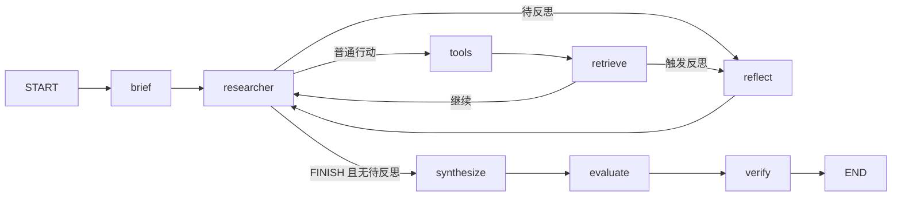

# 研究架构 v2

正式入口 `adra.cli → adra.graph` 不再使用旧任务调度器。

## 参考实现与取舍

以下按本项目文档记录和本次核对的上游源码说明设计来源，不把相似的功能自动认定为代码移植。外部链接指向上游分支，可能变化；这些参考不构成同等效果的承诺。

| 来源与具体入口 | 参考的部分 | 为什么采用 | 本项目如何落地 / 没有照搬什么 |
| --- | --- | --- | --- |
| [Open Deep Research：deep_researcher.py](https://github.com/langchain-ai/open_deep_research/blob/main/src/open_deep_research/deep_researcher.py) 的 `write_research_brief`、`researcher`、`researcher_tools` | 简报驱动模型选择研究行动 | 搜索结果会改变下一步需要查什么，固定任务轮转不够灵活 | `generate_brief()` + `controller()`/`execute()`；没有 supervisor 并行分派子研究者 |
| 同文件的 `compress_research`、`final_report_generation` | 研究结果先整理，再交给写作 | 减少搜索过程与最终表达相互干扰，控制写作输入规模 | `handoff_evidence()` + `synthesize()`；使用原文选段而非模型摘要压缩 |
| [Open Deep Research：utils.py](https://github.com/langchain-ai/open_deep_research/blob/main/src/open_deep_research/utils.py) 的 `tavily_search` | 搜索携带正文并按 URL 去重 | 避免每条搜索结果都再消耗一次 READ 请求 | `include_raw_content=True` + `add_source()`；不复制逐页面模型摘要和并行搜索流程 |
| [STORM：StormInformationTable](https://github.com/stanford-oval/storm/blob/main/knowledge_storm/storm_wiki/modules/storm_dataclass.py) 的 `construct_url_to_info`、`retrieve_information` | 汇集来源后按查询取证据 | 同一来源可能回答多个主题，不应受发现顺序或任务归属限制 | `raw_documents` + 全局 `retrieve()`；不复制多视角访谈，也没有采用其 SentenceTransformer/余弦检索 |
| [rank_bm25：BM25 / BM25Okapi](https://github.com/dorianbrown/rank_bm25/blob/master/rank_bm25.py) | 真实词频统计、TF 饱和与长度归一化 | 避免把词频误写成“词是否出现”，建立可解释的检索基线 | `bm25_scores()` 自行实现；采用正 IDF，参数与该库默认值不同，不保证分数相同 |
| 本项目实验与审查反馈 | 目标状态、事件触发、硬预算、原文偏移校验、评估重试、逐声明核验 | 为 Baseline/Event 实验建立可观测、可定位的行为与失败记录 | 这些具体规则是本项目实现，不归因于 ODR 或 STORM 已有的完整方案 |

LangGraph 是本项目**直接使用的编排框架**，而不是另一个已被复刻的研究 Agent。`StateGraph(dict)`、节点和条件边由库执行；研究策略、预算规则和评分标准由本项目定义。目前 `compile()` 没有配置 checkpointer，因此使用 LangGraph 并不代表已经具备中断恢复。

## 模块边界

- `planning.py`：简报 schema、输入范围校验。兼容旧任务文件，字段不再驱动轮转或成本评分。
- `research_models.py`：SEARCH / READ / RETRIEVE / FINISH 决策合同，含理由与关注主题。
- `policy.py`：模型适配、请求计量、生成简报、研究决策、写作、最终报告判断。
- `graph.py`：LangGraph 阶段编排与预算执行，写作后才调用最终评估。
- `evidence_store.py`：全文按 URL 存储、摘要目录、全局 BM25 片段检索、原文摘要校验。
- `tools.py` / `domains.py`：外部请求、源地址范围校验。
- `coverage.py`：最终评估结构和原文引文校验；保留历史函数兼容测试，但生产调用显式使用全局检索结果。
- `report_evaluation.py`：只对保存的报告重评，无搜索和改写。
- `live_evaluation.py`：固定简报批次、成本记录、人工复核。
- `legacy/`：历史调度器、图、CLI，不被新主流程调用。

## 执行约束

研究者看到简报、来源目录、至多 12000 字符的检索原文、行动观测和剩余预算。它可以生成初始查询列表之外的新查询。每个非 FINISH 动作消耗一步；搜索/抓取消耗一次外部调用，本地检索不消耗外部调用。重复动作与已读 URL 再读被拒绝并留下观测。

搜索正文与 READ 正文保存在原文库，目录只展示短预览。检索从全文重新选段，而非在第一次截断结果上继续检索。RETRIEVE 优先使用动作 argument，再加入所有验收主题查询；其他动作使用 focus。写作时汇合主题查询、有效行动查询和历史完整片段，在字符预算内交接。片段保留偏移与摘要；任务发现记录不充当权限过滤器。

控制器保留一次模型请求给写作，写作完成后最终评估使用剩余请求预算；评估不足或无效引文显示 incomplete，不将其伪装成零分。单次输出 token 上限仍由 RuntimeConfig 控制；模型调用数上限不等于总费用上限。

## 故障与局限

外部工具失败记录安全异常类型并计入请求成本；模型执行失败会由 CLI 保存 failure.json。当前没有中断检查点恢复，失败记录不保证保留失败前所有中间原文。评估器失败在阶段内处理，不销毁已经生成的报告。

BM25 保留英文/API 词项与中文相邻双字的真实词频，使用重叠窗口、TF 饱和及长度归一化，属于轻量检索实现。不会自动理解同义词，也没有 reranker。全文会驻留内存，因此大任务需要进一步限制文档规模或迁移持久化索引。当前单研究者没有并行隔离上下文，长任务的目录与历史仍会增长。

## 审查后补充：目标、反思与声明核验

`research_control.py` 管理与简报分离的目标状态和反思触发规则。`reflection_mode=off/event/always` 可消融；CLI 默认 event，程序调用 `run()` 不传 options 则保留 off/不核验的基础行为，测试和嵌入式调用应显式传入 ResearchOptions。

生产图增加 reflect 节点，反思结果不能改简报，只能更新附带原文引文的暂定目标状态和下一步建议。研究者报告疑似冲突、停滞、过半预算或提前完成时可进入此节点；每步至多一次，总次数和模型请求均受限。始终为后续决策与写作保留请求额度。

最终主题评估之后增加 verify 节点：对报告中的每条 claim，只检索它实际引用的来源并进行语义核验。缺少词法命中时使用写作时的原文片段作为回退。有效引文加模型 verdict 仍不是独立真值。结果单独保存，报告正文不自动改写。

模型输入只保留最近 K 步及旧历史计数摘要，来源目录最多 30 项，全局原文库不受目录截断影响。decisions.jsonl 保存模型实际输入和 FINISH，模型调用记录保存 decision/reflection 系统指令；可检查决策上下文，但没有生成概率，不构成直接可用的 GRPO 数据。

检索方法标记为 `bm25_tf_v2`：保留词频，重叠片段合并。精确定义见 [修改对照](review-followup.md)。

## 实现图与版本标记

此图对应 `graph.build_graph()` 的执行节点；首页架构图则用于说明信息反馈关系。

| 字段 | 当前标记 | 所描述的层级 |
| --- | --- | --- |
| `architecture` | `global_research_v2` | 整体生产流程 |
| `research_revision` | `evidence_reflection_v2` | 研究、反思与交接逻辑 |
| `retrieval_method` | `bm25_tf_v2` | 检索算法版本 |
| `evaluation_provenance.version` | `final_report_retry_v2` | 最终评分与重试版本 |

这些是同一程序不同组件的版本，不是四个独立系统。详见 [实现详解](implementation.md)。
